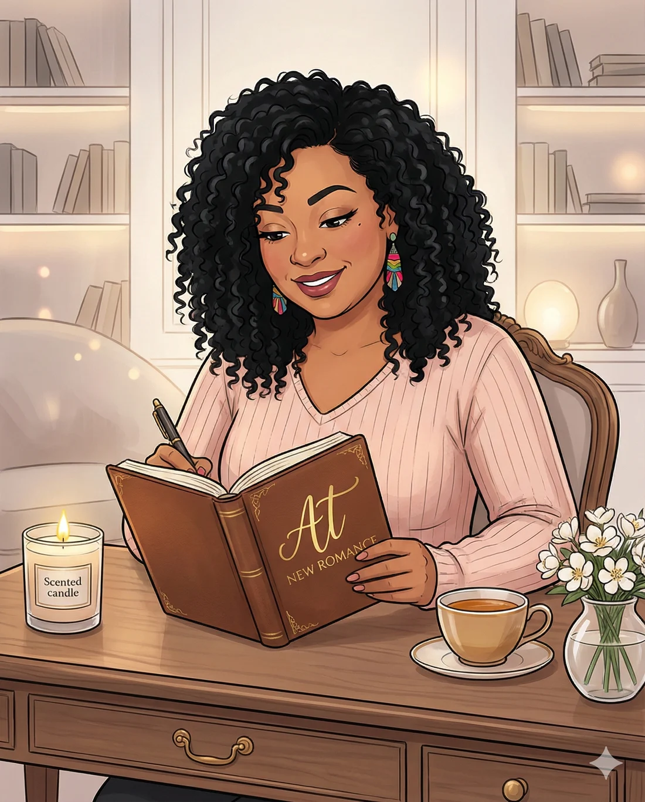
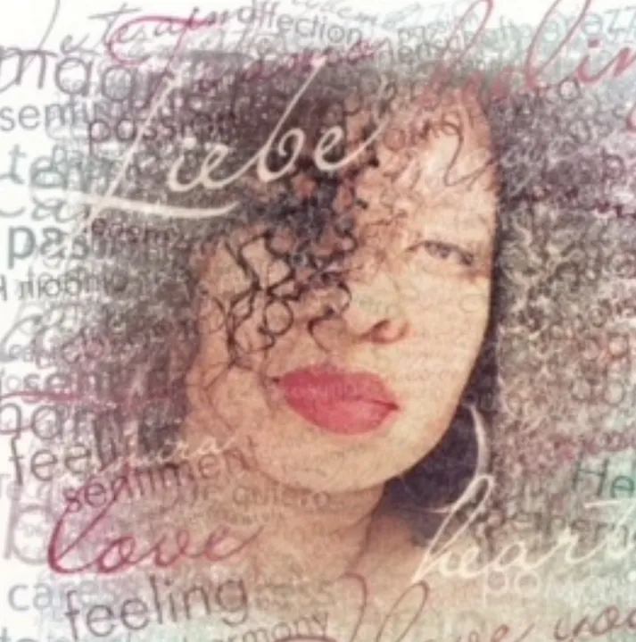
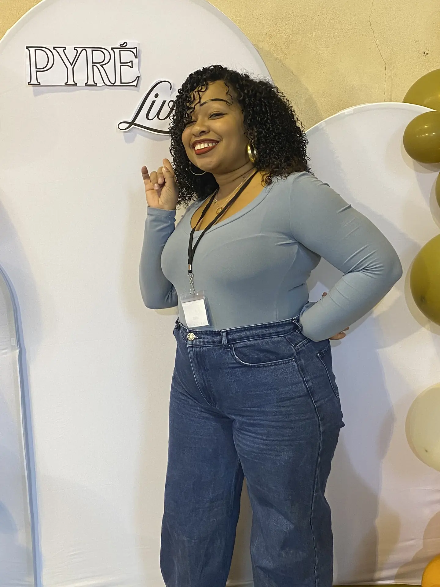

```{=html}
<div class="co">

<!-- ===== Portrait ===== -->
<section class="section apropos" aria-labelledby="titre-apropos">
  <div class="formes" aria-hidden="true"><span class="forme f1"></span><span class="forme f2"></span><span class="forme f3"></span></div>
  <div class="cadre apropos-grille">
    <div class="apropos-visuel">
      <div class="arche">
        <span class="arche-filet" aria-hidden="true"></span>
        <div class="arche-scene"></div>
        <svg class="deco deco-coeur-1" aria-hidden="true"><use href="#i-coeur"/></svg>
        <svg class="deco deco-etoile" aria-hidden="true"><use href="#i-etoile"/></svg>
        <span class="pastille pastille-logo"></span>
        <span class="pastille pastille-mots"></span>
        <span class="legende"><svg class="ico" aria-hidden="true"><use href="#i-plume"/></svg>Mo, à sa table d’écriture</span>
      </div>
    </div>
    <div class="apropos-texte">
      <p class="surtitre">L’auteure</p>
      <h1 id="titre-apropos">Mo Gadarr</h1>
      <p class="apropos-role"><span class="script">Auteure de New Romance engagée</span></p>
      <p class="chapo">Professeur de français, Mo Gadarr s’inspire de son quotidien et de l’actualité pour écrire ses romances.</p>
      <ul class="faits">
        <li><strong style="--fond:var(--beurre-clair)">24</strong><span>romans à découvrir</span></li>
        <li><strong style="--fond:var(--rose-clair)">1er</strong><span>prix du concours Fyctia avec <em>Black Feelings</em></span></li>
        <li><strong style="--fond:var(--sauge-clair)">10+</strong><span>ans à la tête du club théâtre de son établissement</span></li>
        <li><strong style="--fond:var(--peche)">2</strong><span>maisons d’édition, et l’auto-édition</span></li>
      </ul>
      <div class="actions">
        <a class="bouton bouton-cacao" href="romans.html">Voir les romans <span class="rond"><svg class="ico" aria-hidden="true"><use href="#i-fleche"/></svg></span></a>
        <a class="bouton bouton-contour" href="blog.html">Lire le blog</a>
      </div>
    </div>
  </div>
</section>

<!-- ===== Son parcours ===== -->
<section class="section bande parcours" aria-labelledby="titre-parcours">
  <div class="cadre parcours-grille">
    <div class="parcours-texte">
      <header class="entete">
        <p class="surtitre">Son parcours</p>
        <h2 id="titre-parcours">De Fyctia à la <span class="script">Romance engagée</span></h2>
      </header>
      <div class="prose">
        <p>Tout commence sur la plateforme Fyctia avec son premier roman, <strong>Black Feelings</strong>, qui suscite immédiatement de vives réactions et remporte le concours en octobre grâce à sa plume authentique.</p>
        <p>Désormais éditée chez deux maisons prestigieuses dont <em>Black Ink</em>, tout en publiant certaines œuvres en auto-édition, elle incarne la figure de l’auteure hybride moderne. Connectée et engagée, Mo Gadarr souhaite créer un nouveau genre&nbsp;: la <strong>«&nbsp;Romance engagée&nbsp;»</strong>.</p>
        <p>Elle mêle habilement les codes de la New Romance à des sujets de société poignants&nbsp;: les préjugés et le mensonge dans <em>Homme sérieux recherche poupée Bimbo</em>, la pression des traditions dans <em>À Noël, je serai une princesse licorne</em>, ou encore les dangers des rencontres virtuelles dans <em>J’ai juste cliqué&nbsp;!</em>.</p>
        <p>Avec la série <strong>COPS</strong>, elle dénonce les ravages des addictions, tandis que <em>Undress Me</em> explore des thématiques plus sombres comme les traumatismes de l’enfance et le fanatisme religieux.</p>
      </div>
    </div>
    <div class="parcours-cote">
      <article class="tuile t-savoir" aria-labelledby="titre-savoir">
        <span class="t-savoir-icone" aria-hidden="true"><svg class="ico"><use href="#i-theatre"/></svg></span>
        <h3 id="titre-savoir">Le saviez-vous&nbsp;?</h3>
        <p>Elle écrit également ses propres pièces de théâtre qui enchantent petits et grands. Responsable du club théâtre de son établissement depuis plus de dix ans, ses spectacles loufoques et modernes sont très attendus&nbsp;!</p>
        <div class="scene" aria-hidden="true"><span class="scene-frise"></span><span class="scene-sol"></span><span class="scene-etoiles"><svg class="ico"><use href="#i-etoile"/></svg><svg class="ico"><use href="#i-etoile"/></svg><svg class="ico"><use href="#i-etoile"/></svg></span></div>
      </article>
      <figure class="photo-salon">
        
        <figcaption><svg class="ico" aria-hidden="true"><use href="#i-coeur"/></svg>En salon, à la rencontre de ses lecteurs</figcaption>
      </figure>
    </div>
  </div>
</section>

<!-- ===== Et maintenant ? ===== -->
<section class="section suite-auteure" aria-labelledby="titre-suite">
  <div class="cadre">
    <header class="entete centre">
      <p class="surtitre">Et maintenant</p>
      <h2 id="titre-suite">Envie de la <span class="script">lire</span>&nbsp;?</h2>
      <p class="intro">Séries, comédies de Noël, romances de saison et one-shots&nbsp;: il y a une histoire pour chaque humeur.</p>
    </header>
    <div class="actions centre">
      <a class="bouton bouton-cacao" href="romans.html">Explorer les romans <span class="rond"><svg class="ico" aria-hidden="true"><use href="#i-fleche"/></svg></span></a>
      <a class="bouton bouton-contour" href="contactons.html">Contacter Mo</a>
    </div>
  </div>
</section>

</div>
```
