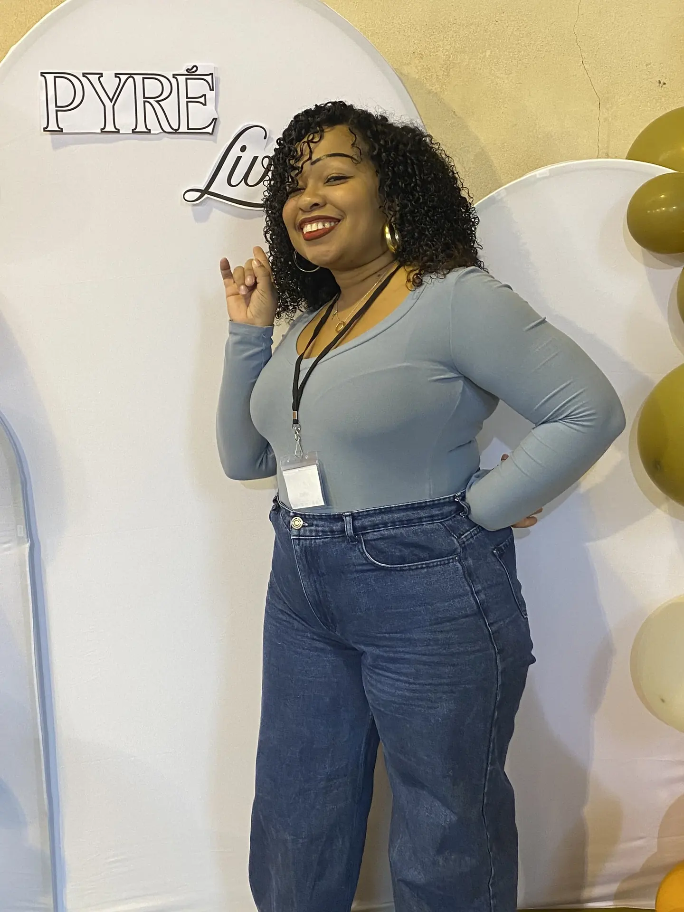

```{=html}
<div class="co">
<section class="section contact" aria-labelledby="titre-contact">
  <div class="formes" aria-hidden="true"><span class="forme f1"></span><span class="forme f2"></span><span class="forme f3"></span></div>
  <div class="cadre">
    <header class="entete centre">
      <p class="surtitre">Contact</p>
      <h1 id="titre-contact">Entrez en <span class="script">relation</span></h1>
      <p class="intro">Mo Gadarr captive ses lectrices par des romances où l’émotion, la sensualité et la tension entre les personnages dominent. Elle aime les silences éloquents, les gestes retenus, et les mots qui brûlent doucement la page.</p>
    </header>

    <div class="contact-grille">
      <article class="tuile t-contact" aria-labelledby="titre-ecrire">
        <span class="t-savoir-icone" aria-hidden="true"><i class="bi bi-envelope-paper-heart"></i></span>
        <h2 id="titre-ecrire">Prendre contact</h2>
        <p>Besoin d’informations presse, d’organiser une séance de dédicaces, d’inviter l’auteure à un salon, ou d’échanger pour une chronique&nbsp;?</p>
        <a class="bouton bouton-cacao" href="mailto:mogadarr@gmail.com?subject=Contact%20site%20Mogadarr&body=Bonjour%20Mo%2C%0D%0A%0D%0AJe%20vous%20%C3%A9cris%20depuis%20votre%20site.%20Ma%20demande%20concerne%20...%0D%0A%0D%0AMerci%20et%20belle%20journ%C3%A9e.">Écrire à Mo Gadarr <span class="rond"><svg class="ico" aria-hidden="true"><use href="#i-fleche"/></svg></span></a>
      </article>

      <article class="tuile t-reseaux" aria-labelledby="titre-reseaux">
        <span class="t-savoir-icone" aria-hidden="true"><i class="bi bi-share"></i></span>
        <h2 id="titre-reseaux">Réseaux sociaux</h2>
        <p>Astuce&nbsp;: taguez l’auteure et mentionnez le titre de l’ouvrage pour faciliter le partage de chroniques.</p>
        <div class="actions">
          <a class="bouton bouton-creme" href="https://www.instagram.com/mogadarrauteur/" target="_blank" rel="noopener"><svg class="ico" aria-hidden="true"><use href="#i-insta"/></svg>@mogadarrauteur</a>
          <a class="bouton bouton-creme" href="https://www.goodreads.com/search?q=Mo%20Gadarr" target="_blank" rel="noopener"><i class="bi bi-book" aria-hidden="true"></i>Goodreads</a>
        </div>
      </article>

      <figure class="photo-salon">
        
        <figcaption><svg class="ico" aria-hidden="true"><use href="#i-coeur"/></svg>En salon, à la rencontre de ses lecteurs</figcaption>
      </figure>
    </div>
  </div>
</section>
</div>
```
