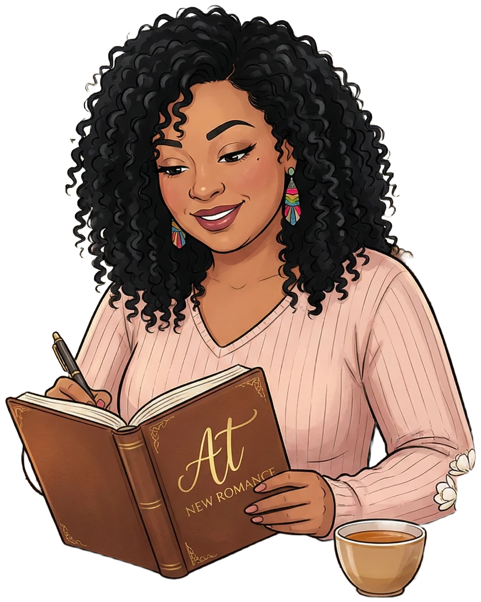
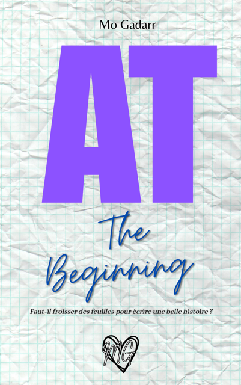
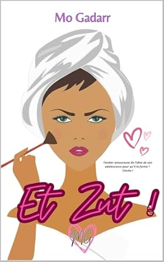
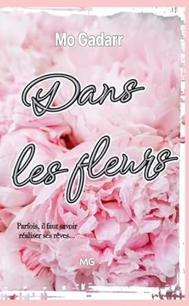
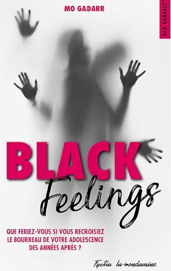

```{=html}
<div class="co">

<!-- ===== Ouverture : Mo à sa table d'écriture ===== -->
<section class="ouverture" aria-labelledby="titre-ouverture">
  <div class="formes" aria-hidden="true"><span class="forme f1"></span><span class="forme f2"></span><span class="forme f3"></span><span class="forme pois"></span></div>
  <div class="cadre ouverture-grille">
    <div class="ouverture-texte">
      <!-- Annonce du moment : à mettre à jour à chaque nouveau roman -->
      <a class="annonce" href="dernier_roman/fille_pere_noel.html">
        <span class="annonce-etiquette">Nouveau<span class="pc-seul"> roman</span></span>
        <span class="annonce-texte">Elle est la fille du Père Noël…</span>
        <svg class="ico" aria-hidden="true"><use href="#i-fleche"/></svg>
      </a>
      <h1 id="titre-ouverture">Des romances<br>qui font <span class="script">du bien</span>.</h1>
      <p class="chapo">Une New Romance engagée qui bouscule les cœurs.</p>
      <div class="actions">
        <a class="bouton bouton-cacao" href="dernier_roman/fille_pere_noel.html">Découvrir le nouveau roman <span class="rond"><svg class="ico" aria-hidden="true"><use href="#i-fleche"/></svg></span></a>
        <a class="bouton bouton-contour" href="#romans"><span>Explorer les <span data-nb-romans>24</span>&nbsp;romans</span></a>
      </div>
      <p class="signature">
        <span class="signature-nom">Mo Gadarr</span>
        <span class="signature-role"><svg class="ico" aria-hidden="true"><use href="#i-coeur"/></svg><span>Auteure de New Romance engagée</span></span>
      </p>
    </div>

    <div class="ouverture-visuel">
      <div class="arche">
        <span class="arche-filet" aria-hidden="true"></span>
        <span class="arche-fond" aria-hidden="true"></span>
        <div class="arche-img"></div>
        <svg class="deco deco-coeur-1" aria-hidden="true"><use href="#i-coeur"/></svg>
        <svg class="deco deco-coeur-2" aria-hidden="true"><use href="#i-coeur"/></svg>
        <svg class="deco deco-etoile" aria-hidden="true"><use href="#i-etoile"/></svg>
        <svg class="deco deco-feuille" aria-hidden="true"><use href="#i-feuille"/></svg>
        <span class="pastille pastille-logo"></span>
        <a class="pastille pastille-24" href="#romans"><span><strong data-nb-romans>24</strong><span>romans</span></span></a>
        <a class="carte-nouveau" href="dernier_roman/fille_pere_noel.html">
          
          <span><b>Le nouveau roman</b><i>Romance de Noël</i></span>
        </a>
        <span class="legende"><svg class="ico" aria-hidden="true"><use href="#i-plume"/></svg>Mo, à sa table d’écriture</span>
      </div>
    </div>
  </div>
</section>

<!-- ===== Bento : tout l'univers d'un coup d'œil ===== -->
<section class="section" id="univers" aria-labelledby="titre-univers" style="padding-top:28px">
  <div class="cadre">
    <header class="entete">
      <p class="surtitre">En ce moment</p>
      <h2 id="titre-univers"><span class="insecable">Tout l’univers de Mo,</span> <span class="insecable">d’un coup d’œil</span></h2>
    </header>

    <div class="bento">
      <!-- 1. Le nouveau roman -->
      <article class="tuile t-nouv" id="nouveau" aria-labelledby="titre-nouveau">
        <a class="t-nouv-couv" href="dernier_roman/fille_pere_noel.html" aria-label="Découvrir le roman">
          
        </a>
        <div class="t-nouv-texte">
          <p class="etiquettes">
            <span class="etiquette etiquette-beurre">Nouveau</span>
            <span class="etiquette etiquette-ligne">Romance de Noël&nbsp;·&nbsp;Disponible</span>
          </p>
          <h3 id="titre-nouveau">Elle est la fille du Père&nbsp;Noël <small>&amp; je suis le fils du Père&nbsp;Fouettard</small></h3>
          <p class="t-nouv-accroche">Deux héritages. Zéro point commun.</p>
          <p class="t-nouv-pitch">Wendy, la fille du Père Noël, rencontre Dante, le fils du Père Fouettard. Et vous, à Noël, quel camp choisirez-vous&nbsp;?</p>
          <ul class="puces" aria-label="Thèmes du roman">
            <li>Amours contrariées</li><li>Deux mondes</li><li>Secrets de famille</li><li>Magie de Noël</li>
          </ul>
          <div class="actions">
            <a class="bouton bouton-creme" href="dernier_roman/fille_pere_noel.html">Découvrir le roman <span class="rond"><svg class="ico" aria-hidden="true"><use href="#i-fleche"/></svg></span></a>
            <a class="lien-clair" href="https://amzn.eu/d/0dbVGnRO" target="_blank" rel="noopener noreferrer">Acheter sur Amazon <svg class="ico" aria-hidden="true"><use href="#i-sortie"/></svg></a>
          </div>
        </div>
      </article>

      <!-- 2. Le filtre photo -->
      <article class="tuile t-filt" aria-labelledby="titre-filtre">
        <p class="etiquettes"><span class="etiquette etiquette-blanche"><svg class="ico" aria-hidden="true"><use href="#i-photo"/></svg>Filtre photo de Noël</span></p>
        <h3 id="titre-filtre">Posez avec Wendy &amp;&nbsp;Dante</h3>
        <p class="t-filt-texte">Choisissez votre camp, activez votre caméra et glissez les héros à côté de vous. Votre photo de Noël est prête à partager.</p>
        <ul class="camps" aria-label="Les deux camps">
          <li><span class="camp-point" style="--c:#C0392B"></span>Team Noëlie</li>
          <li><span class="camp-point" style="--c:#4A3A5C"></span>Team Krampen</li>
        </ul>
        <a class="bouton bouton-cacao t-filt-cta" href="dernier_roman/filtre-noel.html">Essayer le filtre <span class="rond"><svg class="ico" aria-hidden="true"><use href="#i-fleche"/></svg></span></a>
        <span class="t-filt-halo" aria-hidden="true"></span>
        
      </article>

      <!-- 3. Les romans -->
      <article class="tuile t-vingt" aria-labelledby="titre-vingt">
        <p class="t-vingt-chiffre" id="titre-vingt"><strong data-nb-romans>24</strong> <span>romans à découvrir</span></p>
        <p class="t-vingt-texte">Séries, comédies de Noël, romances de saison et one-shots.</p>
        <a class="lien-fleche" href="#romans">Explorer la collection <span class="rond"><svg class="ico" aria-hidden="true"><use href="#i-fleche"/></svg></span></a>
        <span class="eventail eventail-xl" aria-hidden="true">
          
          
          
          
          
        </span>
      </article>

      <!-- 4. Le journal : dernier article du blog (automatique) -->
```

::: {#tuile-journal}
:::

```{=html}
      <!-- 5. La lettre -->
      <article class="tuile t-lettre" aria-labelledby="titre-tuile-lettre">
        <div>
          <p class="surtitre">La lettre d’information</p>
          <h3 id="titre-tuile-lettre">Rejoignez le Cercle des Intimes</h3>
          <p class="texte">Soyez les premiers informés des nouvelles sorties et du contenu exclusif.</p>
        </div>
        <a class="bouton bouton-peche" href="#lettre"><span>S’abonner</span> <svg class="ico" aria-hidden="true"><use href="#i-fleche"/></svg></a>
      </article>

      <!-- 6. Le saviez-vous ? -->
      <article class="tuile t-savoir" aria-labelledby="titre-savoir">
        <span class="t-savoir-icone" aria-hidden="true"><svg class="ico"><use href="#i-theatre"/></svg></span>
        <h3 id="titre-savoir">Le saviez-vous&nbsp;?</h3>
        <p>Elle écrit également ses propres pièces de théâtre qui enchantent petits et grands. Responsable du club théâtre de son établissement depuis plus de dix ans, ses spectacles loufoques et modernes sont très attendus&nbsp;!</p>
        <div class="scene" aria-hidden="true"><span class="scene-frise"></span><span class="scene-sol"></span><span class="scene-etoiles"><svg class="ico"><use href="#i-etoile"/></svg><svg class="ico"><use href="#i-etoile"/></svg><svg class="ico"><use href="#i-etoile"/></svg></span></div>
      </article>
    </div>
  </div>
</section>

<!-- ===== Envies : trouver son prochain coup de cœur (automatique) ===== -->
<section class="section bande envies" id="envies" aria-labelledby="titre-envies">
  <div class="cadre">
    <header class="entete centre">
      <p class="surtitre">Selon l’envie du moment</p>
      <h2 id="titre-envies">Trouver son prochain <span class="script">coup de cœur</span></h2>
      <p class="intro">Envie de rire, de frissonner ou de fêter Noël&nbsp;? Il y a une histoire pour chaque humeur.</p>
    </header>
```

::: {#liste-envies}
:::

```{=html}
  </div>
</section>

<!-- ===== La collection : tous les romans, filtrables par rubrique (automatique) ===== -->
<section class="section" id="romans" aria-labelledby="titre-romans">
  <div class="cadre">
```

::: {#liste-romans}
:::

```{=html}
    <p class="glisser" aria-hidden="true"><svg class="ico"><use href="#i-fleche"/></svg>Faites glisser pour voir tous les romans</p>
    <p class="suite"><a class="lien-fleche" href="romans.html">Voir la page Romans <span class="rond"><svg class="ico" aria-hidden="true"><use href="#i-fleche"/></svg></span></a></p>
  </div>
</section>

<!-- ===== L'auteure ===== -->
<section class="section bande auteure" id="auteure" aria-labelledby="titre-auteure">
  <div class="cadre auteure-grille">
    <div class="auteure-visuel">
      <span class="auteure-dos" aria-hidden="true"></span>
      
      <svg class="deco deco-coeur-1" aria-hidden="true"><use href="#i-coeur"/></svg>
      <span class="pastille pastille-logo"></span>
      <span class="legende"><svg class="ico" aria-hidden="true"><use href="#i-coeur"/></svg>Mo et son roman de Noël</span>
    </div>
    <div class="auteure-texte">
      <p class="surtitre">L’auteure</p>
      <h2 id="titre-auteure">À propos de <span class="script">Mo Gadarr</span></h2>
      <p class="chapo">Professeur de français et auteure hybride, Mo Gadarr mêle romance et sujets de société pour créer une «&nbsp;Romance engagée&nbsp;». D’abord découverte sur Fyctia avec <em>Black Feelings</em>, elle captive désormais ses lecteurs chez Black Ink et en auto-édition.</p>
      <ul class="faits">
        <li><strong style="--fond:var(--beurre-clair)" data-nb-romans>24</strong><span>romans à découvrir</span></li>
        <li><strong style="--fond:var(--rose-clair)">1er</strong><span>prix du concours Fyctia avec <em>Black Feelings</em></span></li>
        <li><strong style="--fond:var(--sauge-clair)">10+</strong><span>ans à la tête du club théâtre de son établissement</span></li>
        <li><strong style="--fond:var(--peche)">2</strong><span>maisons d’édition, et l’auto-édition</span></li>
      </ul>
      <a class="bouton bouton-cacao" href="about.html">Découvrir son parcours <span class="rond"><svg class="ico" aria-hidden="true"><use href="#i-fleche"/></svg></span></a>
    </div>
  </div>
</section>

<!-- ===== Actualités : les 3 derniers articles du blog (automatique) ===== -->
<section class="section actus" id="journal" aria-labelledby="titre-journal">
  <div class="cadre">
    <div class="entete-ligne">
      <header class="entete">
        <p class="surtitre">Le journal de Mo</p>
        <h2 id="titre-journal">Dernières actualités</h2>
      </header>
      <a class="bouton bouton-contour" href="blog.html">Toutes les actualités</a>
    </div>
```

::: {#liste-actus}
:::

```{=html}
  </div>
</section>

<!-- ===== Lettre d'information ===== -->
<section class="lettre" id="lettre" aria-labelledby="titre-lettre">
  <span id="newsletter"></span><!-- ancienne ancre, conservée pour les liens existants -->
  <div class="enveloppe">
    <span class="enveloppe-dos" aria-hidden="true"></span>
    <div class="mot">
      <span class="timbre" aria-hidden="true"></span>
      <svg class="obliteration" viewBox="0 0 84 44" aria-hidden="true"><path d="M2 8c7-6 13-6 20 0s13 6 20 0 13-6 20 0 13 6 20 0M2 22c7-6 13-6 20 0s13 6 20 0 13-6 20 0 13 6 20 0M2 36c7-6 13-6 20 0s13 6 20 0 13-6 20 0 13 6 20 0" fill="none" stroke="currentColor" stroke-width="2.4" stroke-linecap="round"/></svg>
      <p class="surtitre">La lettre d’information</p>
      <h2 id="titre-lettre">Rejoignez le Cercle des Intimes</h2>
      <p class="texte">Soyez les premiers informés des nouvelles sorties et du contenu exclusif.</p>
      <form class="formulaire" id="newsletterForm" novalidate>
        <label class="visually-hidden" for="newsletterEmail">Votre adresse e-mail</label>
        <input id="newsletterEmail" type="email" name="courriel" placeholder="Votre adresse e-mail" autocomplete="email" required>
        <button class="bouton bouton-cacao" type="submit"><span>S’abonner</span></button>
      </form>
      <p class="mention" id="newsletterMention" aria-live="polite">Désinscription possible à tout moment.</p>
    </div>
    <span class="enveloppe-poche" aria-hidden="true"></span>
    <span class="sceau" aria-hidden="true"><svg class="ico"><use href="#i-coeur"/></svg></span>
  </div>
</section>

</div>

<script>
document.addEventListener('DOMContentLoaded', function () {
  /* Nombre de romans : compté dans la collection affichée (plus rien à mettre à jour à la main). */
  var cartes = document.querySelectorAll('#livres .livre');
  if (cartes.length) {
    document.querySelectorAll('[data-nb-romans]').forEach(function (el) { el.textContent = cartes.length; });
  }

  /* Filtres de la collection, par rubrique */
  var filtres = document.getElementById('filtres'), livres = document.getElementById('livres');
  if (filtres && livres) {
    filtres.addEventListener('click', function (ev) {
      var b = ev.target.closest('.filtre');
      if (!b) { return; }
      filtres.querySelectorAll('.filtre').forEach(function (x) { x.setAttribute('aria-pressed', x === b); });
      cartes.forEach(function (c) { c.hidden = b.dataset.rubrique !== 'tous' && c.dataset.rubrique !== b.dataset.rubrique; });
      livres.scrollLeft = 0;
    });
  }

  /* Lettre d'information : ouvre un e-mail d'inscription prêt à envoyer (fonctionnement inchangé). */
  var formulaire = document.getElementById('newsletterForm'), champ = document.getElementById('newsletterEmail'), mention = document.getElementById('newsletterMention');
  if (formulaire && champ) {
    formulaire.addEventListener('submit', function (e) {
      e.preventDefault();
      var email = champ.value.trim();
      if (!/^[^\s@]+@[^\s@]+\.[^\s@]+$/.test(email)) {
        if (mention) { mention.textContent = 'Veuillez saisir une adresse e-mail valide.'; mention.classList.add('erreur'); }
        champ.focus();
        return;
      }
      if (mention) { mention.textContent = 'Votre messagerie s’ouvre : il ne reste qu’à envoyer le message.'; mention.classList.remove('erreur'); }
      var sujet = encodeURIComponent('Inscription Newsletter');
      var corps = encodeURIComponent('Bonjour Mo,\n\nJe souhaite m\'inscrire à la newsletter.\n\nMon email : ' + email + '\n\nMerci !');
      window.location.href = 'mailto:mogadarr@gmail.com?cc=' + encodeURIComponent(email) + '&subject=' + sujet + '&body=' + corps;
    });
  }
});
</script>
```
