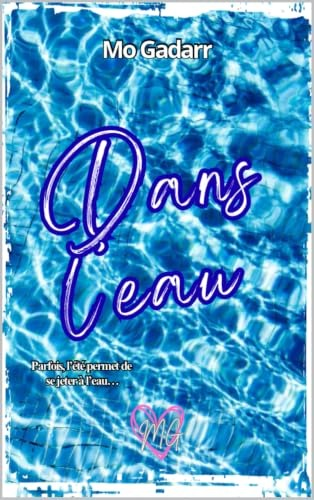

```{=html}
<header class="book-hero">
    <div class="book-hero-bg" style="background-image: url('../images/couvertures/dans-l-eau.jpg');"></div>
    <div class="book-hero-content">
        <div class="book-hero-card fade-in">
            <div class="book-hero-cover-wrapper">
                
            </div>
            <div class="book-hero-info">
                <span class="book-genre-pill">Romance Contemporaine • Été</span>
                <h1>Dans l'eau</h1>
                <p class="book-tagline">Parfois, l’été permet de se jeter à l’eau…</p>

                <div class="formats-prix-premium">
                    <div class="format-item">
                        <span class="format-name">Ebook</span>
                        <span class="format-price">Disponible</span>
                    </div>
                    <div class="format-item">
                        <span class="format-name">Mini broché</span>
                        <span class="format-price">Disponible</span>
                    </div>
                </div>

                <div class="book-synopsis">
<p>Lottie est prête à tout pour redonner un second souffle à son couple. Son petit ami en vaut vraiment le coup. Aussi, elle casse sa tirelire, se met dans une situation financière délicate et lui offre le séjour dont il rêve depuis des mois. Départ pour l’île Maurice dans une villa paradisiaque pourvue de tout ce qui peut faire envie durant l’été : de grands espaces, un mobilier grand luxe et…une piscine, gigantesque, elle aussi !</p>
<p>Notre héroïne met de côté sa phobie de l’eau pour passer des vacances inoubliables. Mais la vie s’en mêle et c’est finalement seule et fauchée que Lottie embarque pour cette destination paradisiaque. Une fois là-bas, les choses vont franchement se dégrader. Le destin lui recolle en plus dans les pattes un individu qu’elle n’avait pas vu depuis des années : son « frère » par alliance, Louis, installé sur l'île depuis des années.</p>
<p>Lottie pourrait fermer les yeux et ignorer cet homme qu’elle déteste désormais mais elle va apprendre que l’été, c’est toujours le moment de se jeter à l’eau, d’affronter ce qui nous fait peur pour enfin espérer avancer.</p>
<p><strong>Mo Gadarr revient avec une romance aussi rafraichissante que pimentée !</strong></p>
</div>

<div class="book-actions">
                    <a href="https://amzn.eu/d/08hBIhNI" class="btn-primary" target="_blank">Acheter sur Amazon</a>

    <a href="../romans.html" class="btn-text"><i class="bi bi-arrow-left"></i> Retour</a>
</div>
            </div>
        </div>
    </div>
</header>

```


```{=html}
<!-- Floating Mobile Navigation -->
<div class="mobile-nav-actions" id="mobileNav">
  <button id="backToTopBtn" class="nav-btn-floating" aria-label="Retour en haut">
    <i class="bi bi-arrow-up-short"></i>
  </button>
</div>

<script>
document.addEventListener('DOMContentLoaded', () => {
    const mobileNav = document.getElementById('mobileNav');
    const backToTopBtn = document.getElementById('backToTopBtn');

    if (mobileNav && backToTopBtn) {
        window.addEventListener('scroll', () => {
            if (window.scrollY > 500) {
                mobileNav.classList.add('visible');
            } else {
                mobileNav.classList.remove('visible');
            }
        });

        backToTopBtn.addEventListener('click', () => {
            window.scrollTo({
                top: 0,
                behavior: 'smooth'
            });
        });
    }
});
</script>
```
